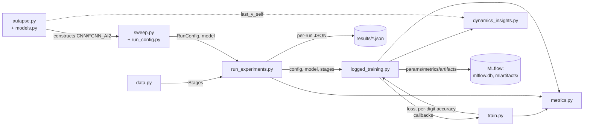

# robgoal

A multi-week project on implementing neural networks capable of robust goal-keeping; specifically tackling catastrophic forgetting of features.

More detailed notes can be found in  the `docs` folder, particularly in `docs/Mini_project_meta_continual_learning.md`.

## Architecture

How the pieces in `src/` interact when running the sweep (see
`docs/implementation_doc.md` for the full module-by-module breakdown):



## Set-up

Use [`uv`](https://docs.astral.sh/uv/), together with the preferred Pytorch version (CPU-only or CUDA), to reproduce our Python environment:

```sh
uv sync --extra=cpu

# or, if you want to use CUDA:
uv sync --extra=cu130
```

## Running experiments

Run the full sweep (autapsic-inhibition variants/schemes, plus a `T` /
`epochs_per_stage` / hidden-layer-size sweep — see `docs/lab-book.md`,
"Implemented tests") from the repo root:

```sh
uv run python src/run_experiments.py
```

This downloads MNIST on first run (to `data/`), trains every config in
`src/sweep.py`'s sweep, and:

- writes each run's per-stage accuracy to `results/{name}.json`,
- prints an accuracy matrix + summary line per run,
- live-logs params/metrics to a local [MLflow](https://mlflow.org/) tracking
  database (`mlflow.db`, with artifacts in `mlartifacts/`).

To watch runs live while the sweep is running (or afterward), start the
MLflow UI in another terminal from the repo root:

```sh
uv run mlflow ui --backend-store-uri sqlite:///mlflow.db
```

then open `http://localhost:5000`.

### Adjusting the sweep

- **Which configs run**: edit the constants at the top of `src/sweep.py`
  (`VARIANTS`, `SCHEMES`, `BASE_T`, `T_SWEEP`, `EPOCHS_SWEEP`,
  `HIDDEN_SIZES_SWEEP`, `ANCHOR_VARIANT`, `ANCHOR_SCHEME`) or extend
  `build_configs()` directly with more `RunConfig`s.
- **Seed replicates**: `NUM_SEEDS` in `src/run_experiments.py` defaults to
  `1` (fast, single-seed sweep). Set it higher (e.g. `3`) to run each config
  as that many seed replicates instead, grouped under one MLflow parent run
  per config with mean/stdev summary metrics — multiplies total training
  runs, so it's opt-in.
- **A single config, without the rest of the sweep**: build a `RunConfig`
  (or take one from `sweep.build_configs()`) and call `sweep.build_model` +
  `logged_training.run_and_log` directly. The sibling imports below need
  `src/` importable (see `docs/implementation_doc.md`, "Files") — save this
  as a script under `src/` and run it from the repo root, or run
  `PYTHONPATH=src uv run python -c "..."`:

  ```python
  import torch
  from data import build_stages, get_mnist_data
  from logged_training import run_and_log
  from sweep import build_configs, build_model

  train_data, test_data = get_mnist_data(root="data")  # from the repo root
  stages = build_stages(train_data, test_data)
  config = build_configs()[0]  # or construct your own RunConfig
  torch.manual_seed(config.seed)
  run_and_log(config, build_model(config), stages, torch.device("cpu"))
  ```

See `docs/implementation_doc.md` for what each module does, and
`docs/lab-book.md` for the research reasoning behind the sweep design.

## Tests

```sh
uv run pytest -q
```
