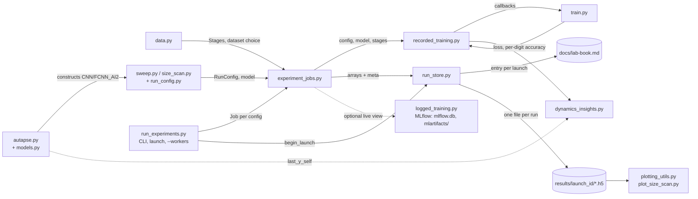

# robgoal

A multi-week project on implementing neural networks capable of robust goal-keeping; specifically tackling catastrophic forgetting of features.

More detailed notes can be found in  the `docs` folder, particularly in `docs/Mini_project_meta_continual_learning.md`.

## Architecture

How the pieces in `src/` interact when running the sweep (see
`docs/implementation_doc.md` for the full module-by-module breakdown):



## Set-up

Use [`uv`](https://docs.astral.sh/uv/), together with the preferred Pytorch version (CPU-only or CUDA), to reproduce our Python environment:

```sh
uv sync --extra=cpu

# or, if you want to use CUDA:
uv sync --extra=cu130
```

## Running experiments

Run the full sweep (autapsic-inhibition variants/schemes, plus a `T` /
`epochs_per_stage` / hidden-layer-size sweep — see `docs/old-lab-book.md`,
"Implemented tests") from the repo root. Every launch needs `--goal`,
`--method` and `--code-changes` (free text for the run log) and a clean git
tree (commit or stash first; this is how every result file stays attributable
to a commit):

```sh
uv run python src/run_experiments.py --goal "why" --method "how" --code-changes "none"
```

This downloads MNIST on first run (to `data/`), trains every config in
`src/sweep.py`'s sweep, and:

- appends an entry (launch id, commit, command, your text) to `docs/lab-book.md`,
- writes one HDF5 file per run to `results/{launch_id}/{run_name}.h5`, holding
  the full config, git provenance and the arrays (per-stage accuracy, loss per
  epoch, `y_self`); open them with `src/run_store.py` / `src/plotting_utils.py`,
- prints an accuracy matrix + summary line per run (sequential launches; with
  `--workers N` one progress line per finished job),
- live-logs params/metrics to a local [MLflow](https://mlflow.org/) tracking
  database (`mlflow.db`, with artifacts in `mlartifacts/`) unless you pass
  `--no-mlflow`; MLflow is only a viewer, the `.h5` files are the record.

`--workers N` runs N configs in parallel worker processes. To watch runs live
while the sweep is running (or afterward), start the MLflow UI in another
terminal from the repo root:

```sh
uv run mlflow ui --backend-store-uri sqlite:///mlflow.db
```

then open `http://localhost:5000`. `scan-list.md` has the commands for every
scan, including the plotting step.

### Adjusting the sweep

Both `main()` (the base sweep) and `run_size_scan()` (below) take the same
`--num-seeds`/`--dataset`/`--initial-classes`/`--classes-per-stage`/`--workers`/
`--no-mlflow` CLI flags (plus the required `--goal`/`--method`/`--code-changes`),
also usable as keyword args when calling either function directly (`...` below
stands for those three):

```sh
uv run python src/run_experiments.py --num-seeds 5 --dataset fashion_mnist --initial-classes 1 ...
uv run python src/run_experiments.py --scan size --num-seeds 5 ...
```

- **Which configs run**: edit the constants at the top of `src/sweep.py`
  (`VARIANTS`, `SCHEMES`, `BASE_T`, `T_SWEEP`, `EPOCHS_SWEEP`,
  `HIDDEN_SIZES_SWEEP`, `ANCHOR_VARIANT`, `ANCHOR_SCHEME`) or extend
  `build_configs()` directly with more `RunConfig`s.
- **Seed replicates**: `--num-seeds`/`num_seeds` (both default `1`: fast,
  single-seed, deterministic seed `0`). Set it higher (e.g. `3`) to run each
  config as that many replicates instead, each with a randomly drawn seed
  (recorded in each run file's `meta` and file name, and as the `seed` MLflow
  param, for reproducibility) — grouped under one MLflow parent run per
  config with mean/stdev summary metrics. Multiplies total training runs, so
  it's opt-in.
- **Dataset**: `--dataset`/`dataset`, `"mnist"` (default) or
  `"fashion_mnist"`. Runs on a non-default dataset get their run name
  suffixed with the dataset name (launches have separate directories, so
  results are never overwritten either way).
- **Initial vs. sequential class split**: `--initial-classes`/
  `initial_classes` (default `5`) and `--classes-per-stage`/
  `classes_per_stage` (default `1`) control `data.build_stage_digits`'s
  split — e.g. `initial_classes=1, classes_per_stage=1` starts from a single
  class and adds one more per stage all the way through.
- **Shrinking-network scan**: `uv run python src/run_experiments.py --scan
  size`, or `run_experiments.run_size_scan()` — runs `src/size_scan.py`'s
  scan (ai2 variants, FCNN controls, and the CNN control, all at
  progressively smaller widths/channel counts) instead of the base sweep, to
  see how ai2 vs. controls degrade as capacity shrinks. Override the widths
  via `hidden_sizes_scan`/`channels_scan`.
- **A single config, without the rest of the sweep**: build a `RunConfig`
  (or take one from `sweep.build_configs()`) and launch it with
  `run_experiments.run_launch`, which does the provenance/lab-book/file
  handling. The sibling imports below need `src/` importable (see
  `docs/implementation_doc.md`, "Files") — save this as a script under `src/`
  and run it from the repo root, or run `PYTHONPATH=src uv run python -c
  "..."`:

  ```python
  from run_experiments import LaunchEnv, LaunchRequest, run_launch
  from sweep import build_configs

  request = LaunchRequest(
      goal="why", method="how", code_changes="none", command="ad-hoc run_launch"
  )
  run_launch(build_configs()[:1], request, "sweep", LaunchEnv())  # needs a clean tree
  ```

See `docs/implementation_doc.md` for what each module does, and
`docs/old-lab-book.md` for the research reasoning behind the sweep design.

## Tests

```sh
uv run pytest -q
```
